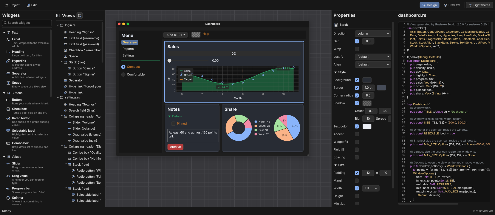

# Rustroke Toolkit

A visual designer for [rustroke](https://crates.io/crates/rustroke) user
interfaces: compose windows by picking widgets from menus or by writing Rust
code. The canvas and the code stay in sync while you edit, in both
directions.



- **Widgets** (leftmost): every widget and layout, by category, with an
  icon and a short explanation; type to search. Click one to add it, or drag
  it onto the component tree or the canvas.
- **Views**: every view is a window of your app and one `.rs` file in your
  project, shown with the tree of its components. Drag components to move
  them, also into containers or to another view.
- **Canvas** (center): the window at its real size on a grey grid; drag its
  title bar to move it. Click a widget to select it, drag it to move it, drop
  widgets where they should go (a line or an outline shows the place);
  resizable windows have a handle to change their size. **Preview** mode
  makes the widgets work for real.
- **Properties**: edit the selected widget, or the window (title, size,
  resizable, minimum and maximum size) when nothing is selected. Besides
  texts, bindings and options, the **Style** and **Size** sections set
  colors, borders, corner radius, shadows and fonts, minimum, maximum and
  fixed sizes, and the colors and spacing of everything inside a container
  or a whole view.
- **Layouts**: panels along a side of a view (a sidebar as tall as the
  window, with a minimum and maximum width) and the central panel for the
  rest; stacks (columns, rows or items one over the other; `ui.vertical`
  and `ui.horizontal` when they have no options) and grids, both
  in a box with a background, border, shadow, padding and a width and
  height that follow the content, fill the space or are fixed, with
  limits; stack items that grow, grid columns of fixed or shared widths and
  cells that span columns and rows.
- **Charts**: plots with line and point series, reference lines, axis
  titles and a legend, and pie or donut charts, bound to fields of the
  view; the canvas shows them with example data.
- **Code** (right): the generated rustroke code, with syntax colors and line
  numbers. Edit it and the canvas follows; code the toolkit doesn't
  recognize is kept as written, comments included.
- **Undo/redo** (Cmd/Ctrl+Z, Shift+Cmd/Ctrl+Z) for every change, typing in a
  field or in the code counting as one step; **cut, copy and paste** widgets
  with their children, also between views.
- **Projects**: save a folder with one file per view, a `mod.rs` and a small
  manifest; open it again later or use the files directly in your app.

## Versions

| Rustroke Toolkit | rustroke |
|---|---|
| 1.x | 0.19 |
| 2.x | 0.20 |

The toolkit's major version changes when it moves to a new rustroke version
(whose API the generated code uses); minor versions add features, patch
versions fix bugs. Each generated file starts with the versions it was made
with.

## Running

```sh
cargo run --release
```

Requires Rust 1.89 or newer. Desktop: macOS, Windows, Linux.

## The generated code

Each view becomes a struct holding its state (one field per bound widget), its
window settings and a `show` method:

```rust,ignore
// View generated by Rustroke Toolkit 2.0.0 for rustroke 0.20 (https://crates.io/crates/rustroke).
use rustroke::{Button, Color, TextEdit, Ui, UiRoot, Window, WindowOptions, vec2};

#[derive(Debug, Default)]
pub struct Login {
    pub username: String,
    pub remember: bool,
}

impl Login {
    /// Window title.
    pub const TITLE: &'static str = "Sign in";

    /// Window size in points: width, height.
    pub const SIZE: (f32, f32) = (360.0, 300.0);

    /// Whether the user can resize the window.
    pub const RESIZABLE: bool = false;

    /// Smallest size the user can resize the window to.
    pub const MIN_SIZE: Option<(f32, f32)> = None;

    /// Largest size the user can resize the window to.
    pub const MAX_SIZE: Option<(f32, f32)> = None;

    /// Options to open the view as the app's native window.
    pub fn window_options() -> WindowOptions { /* … */ }

    /// Shows the view in a window inside the app.
    pub fn show_window(&mut self, root: &mut impl UiRoot) { /* … */ }

    /// Draws the view.
    pub fn show(&mut self, ui: &mut Ui<'_>) {
        ui.style_mut().visuals.accent = Color::from_srgb8(46, 160, 103);
        ui.heading("Sign in");
        ui.add(TextEdit::singleline(&mut self.username).hint_text("Username").corner_radius(6.0));
        ui.checkbox(&mut self.remember, "Remember me");
        if ui
            .add(Button::new("Sign in").fill(Color::from_srgb8(46, 160, 103)).min_size(vec2(96.0, 32.0)))
            .clicked()
        {
            // Your code here is kept when the view is edited again.
        }
    }
}
```

Use it as the app's main window:

```rust,ignore
struct App {
    login: views::login::Login,
}

impl rustroke::App for App {
    fn update(&mut self, frame: &mut rustroke::Frame) {
        frame.ui(|ui| self.login.show(ui));
    }
}

fn main() -> Result<(), rustroke::RunError> {
    let app = App { login: Default::default() };
    rustroke::run(views::login::Login::window_options(), app)
}
```

or inside another window with `self.login.show_window(frame)`.

### What the toolkit reads back

The code panel and opened projects are read with `syn`. Statements that
match what the generator writes become widgets on the canvas; anything else
(loops, conditions, your own calls) becomes a block of free code, kept
exactly as written and shown as a placeholder. Extra fields, methods and
items in the file are kept too. `window_options` and `show_window` are always
regenerated.

Views written for rustroke 0.19 (toolkit 1.x) open too: the layouts that
rustroke 0.20 deprecated (`Container`, `Flex`, `FlexGrid`) become stacks and
grids, and are written back with the new API.

## Known limitations

- Images, icons, tables and tab bars are not in the palette yet: they need
  files or data the toolkit's model doesn't hold. The same goes for bar
  charts, heat maps and plot texts, and for box backgrounds with a gradient
  or an image; write them as code (inside a plot, free code is kept).
- A view's window background (`Window::frame`) can't be set; put a stack
  that fills the width and height at the top of the view instead.
- Generated code is formatted with `prettyplease`, close to but not exactly
  `rustfmt`.

## Development

```sh
cargo test --workspace
cargo clippy --workspace --all-targets -- -D warnings
cargo fmt --all --check
cargo deny check
```

| Crate | Role |
|---|---|
| `rtk-document` | Document model, code generator, parser, project files (no GUI) |
| `rtk-preview` | Draws a view with rustroke (design canvas and preview) |
| `rustroke-toolkit` | The application |
| `rtk-codegen-check` | Compiles the code generated for the example project |

## License

Licensed under either of [MIT](LICENSE-MIT) or [Apache-2.0](LICENSE-APACHE)
at your option. Only dependencies with permissive licenses are used
(enforced with `cargo deny`). The code generated by the toolkit is yours.
